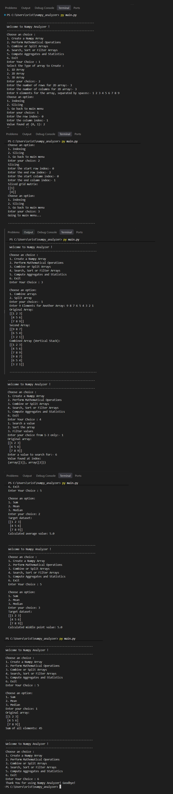

# 1\. Project Title

# NumPy Analyzer

A Python-based command-line application for creating, analyzing, and manipulating NumPy arrays.

## 2\. Project Description

NumPy Analyzer is a menu-driven Python application developed using the NumPy library. It allows users to create and perform various operations on 1D, 2D, and 3D arrays through a simple interactive interface.

The project demonstrates fundamental NumPy operations, including array indexing, slicing, mathematical calculations, searching, sorting, filtering, combining, splitting, and statistical analysis.

It is designed to help beginners understand NumPy arrays and their applications in data analysis.

## 3\. Features

| Feature | Description |
| --- | --- |
| Array Creation | Create 1D, 2D, and 3D NumPy arrays. |
| Indexing | Access individual elements using index positions. |
| Slicing | Extract specific portions of arrays. |
| Mathematical Operations | Perform addition, subtraction, multiplication, and division. |
| Searching | Search for specific values and find their index positions. |
| Sorting | Sort array elements using NumPy. |
| Filtering | Filter elements based on greater-than and less-than conditions. |
| Array Combining | Combine arrays using vertical stacking. |
| Array Splitting | Split arrays into multiple sub-arrays. |
| Statistical Operations | Calculate the sum, mean, and median of array elements. |
| Interactive Menu | Navigate between operations through a menu-driven interface. |

## 4\. Technologies

| Technology | Purpose |
| --- | --- |
| Python | Core programming language used to develop the application. |
| NumPy | Used for array creation, manipulation, mathematical calculations, and statistical operations. |
| Visual Studio Code (VS Code) | Code editor used to write and manage the Python program. |
| Git | Version control system used to track code changes. |
| GitHub | Platform used to host and share the project repository. |

## 5\. How to Run | Installation

### Prerequisites

- Python 3 installed on your system.
- pip package manager.
- Visual Studio Code (recommended).
- Git (optional, for cloning the repository).

### Step 1: Clone or Download the Project

Clone the repository using Git:

bash

```
git clone <your-repository-url>
```

Navigate to the project directory:

bash

```
cd numpy-analyzer
```

Alternatively, download the project files and open the folder in VS Code.

### Step 2: Install NumPy

Open the terminal in VS Code and execute:

bash

```
pip install numpy
```

### Step 3: Run the Program

Save the Python code in a file named `main.py` and execute:

bash

```
python main.py
```

If your system uses the `python3` command, run:

bash

```
python3 main.py
```

### Step 4: Use the Application

1. Select **1** to create a NumPy array.
2. Choose the array dimension: 1D, 2D, or 3D.
3. Enter the required elements.
4. Select an operation from the main menu.
5. Follow the on-screen instructions.
6. Select **6** to exit the application.

## 6\. Project Structure

text

```
├──main.py
├── output.png
└── README.md
```

### Main Components

| Component | Description |
| --- | --- |
| `DataAnalytics` | Class containing the array creation and analysis methods. |
| `create_array()` | Creates 1D, 2D, or 3D NumPy arrays. |
| `indexing_operations()` | Performs array indexing and slicing. |
| `math_operation()` | Performs addition, subtraction, multiplication, and division. |
| `search_arr()` | Provides searching, sorting, and filtering operations. |
| `combine_arrays()` | Combines arrays using vertical stacking or splits arrays into sub-arrays. |
| `Aggregates_operations()` | Calculates the sum, mean, and median. |
| `main_menu()` | Displays the application's main menu. |
| `start_program()` | Controls the program's execution and menu navigation. |

## 7\. Output


## 8\. Author

**Author:** \[SRIJAN KUMAR MAURYA\]

**Project Name:** NumPy Analyzer

**Description:** A Python project demonstrating NumPy array manipulation and basic data analysis operations.

---

